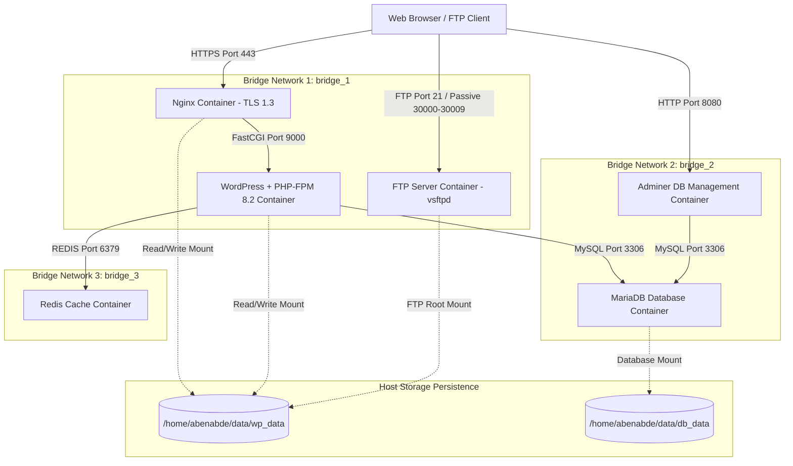

# Inception — Docker Infrastructure & Network Expansion Plan

This repository contains the containerized web infrastructure for **Inception** built using Docker Compose and custom Debian-based microservices.

---

## 📌 Active Infrastructure vs. Planned Expansion

The infrastructure currently runs three core services and is being expanded with three additional nodes:

| Service Node | Status | Base Image | Primary Function | Connected Networks |
| :--- | :--- | :--- | :--- | :--- |
| **Nginx** | Active | `debian:12.15` | HTTPS Reverse Proxy (TLS 1.3) | `bridge_1` |
| **WordPress** | Active | `debian:12.15` | PHP 8.2 Web Application | `bridge_1`, `bridge_2`, `bridge_3` |
| **MariaDB** | Active | `debian:12.15` | Relational Database | `bridge_2` |
| **Redis Cache** | Active (Phase 1) | `debian:12.15` | In-memory Object Cache for WordPress | `bridge_3` |
| **FTP Server** | Active (Phase 2) | `debian:12.15` | File transfer to shared WP/Nginx volume | `bridge_1` |
| **Adminer** | Testing (Phase 3) | `debian:12.15` | Database Management Web Interface | `bridge_2` |

---

## 🗺️ Complete Target Network Architecture



---

## 🚀 Expansion Plan & Implementation Order

We have established a **4-Phase Implementation Roadmap** based on service dependencies, installation complexity, and stability.

### 📋 Phase 1: Redis Cache Node
- **Rationale**: Self-contained service with no dependencies on other new nodes. Immediate performance gain for WordPress object caching. Low installation complexity.
- **Base Image Rule**: `debian:12.15`
- **Minimal Setup Strategy**:
  - Install `redis-server` minimal package.
  - Disable protected mode & bind to `0.0.0.0` for container communication.
  - Set memory management (`maxmemory 256mb`, `maxmemory-policy allkeys-lru`).
  - Direct execution without bloat: `redis-server --protected-mode no`.

### 📋 Phase 2: FTP Server Node
- **Rationale**: Interacts directly with the existing `wp-data` volume shared between WordPress and Nginx. Independent of database or caching layers. Medium installation complexity.
- **Base Image Rule**: `debian:12.15`
- **Minimal Setup Strategy**:
  - Install `vsftpd` package.
  - Minimal configuration: enable local users, disable anonymous access, point `local_root` to `/home/abenabde/data`.
  - Create FTP user from `.env` environment variables.
  - Expose FTP control port `21` and passive port range `30000-30009`.

### 📋 Phase 3: Adminer Management Node
- **Rationale**: Web GUI management tool for MariaDB. Relies on the database container being healthy on `bridge_2`. Low-to-medium complexity.
- **Base Image Rule**: `debian:12.15`
- **Minimal Setup Strategy**:
  - Install `adminer`, `php-cli`, and `php-mysql` packages directly via official Debian APT.
  - Serve using PHP built-in lightweight web server: `php -S 0.0.0.0:8080 -t /usr/share/adminer/adminer`.
  - No heavyweight Nginx or Apache dependency required inside Adminer container.

### 📋 Phase 4: Integration & WordPress Configuration
- **Rationale**: Connect WordPress to the newly added services (`redis` & `mariadb`).
- **Integration Steps**:
  - Add `php8.2-redis` package to `wordpress/Dockerfile`.
  - Inject Redis connection constants in WordPress `wp-config.php`:
    ```php
    define('WP_REDIS_HOST', 'redis');
    define('WP_REDIS_PORT', 6379);
    define('WP_CACHE', true);
    ```
  - Update `srcs/docker-compose.yml` with all new service blocks, networks, and environment variables.

---

## 🔍 Service Functional Descriptions & Inter-Service Connections

### 1. Existing Core Services

#### Nginx
- **Function**: Entry point for all HTTPS traffic. Terminates SSL/TLS 1.3 and serves static files from `/home/abenabde/data`.
- **Connections**:
  - Listens on host port `443`.
  - Proxies `.php` requests to `wordpress:9000` via FastCGI on `bridge_1`.

#### WordPress + PHP-FPM
- **Function**: Dynamic content generation and CMS application logic.
- **Connections**:
  - Receives FastCGI requests from `nginx` on port `9000` (`bridge_1`).
  - Connects to `mariadb:3306` for SQL storage on `bridge_2`.
  - (Planned) Connects to `redis:6379` for object caching on `bridge_2`.

#### MariaDB
- **Function**: Relational SQL database storing WordPress tables, users, and posts.
- **Connections**:
  - Listens on port `3306` inside internal `bridge_2` network only.
  - Accepts connections from `wordpress` and (Planned) `adminer`.

---

### 2. New Nodes Minimal Blueprints

#### Node 1: Redis Cache (`srcs/requirements/redis`)
- **Minimal Dockerfile**:
  ```dockerfile
  FROM debian:12.15
  RUN apt update && apt install -y redis-server && rm -rf /var/lib/apt/lists/*
  EXPOSE 6379
  CMD ["redis-server", "--protected-mode", "no", "--bind", "0.0.0.0"]
  ```
- **How Connection Works**: WordPress PHP scripts use the `php8.2-redis` extension to connect to `redis:6379` over `bridge_2`. Database queries are cached in memory to reduce MariaDB load.

#### Node 2: FTP Server (`srcs/requirements/ftp`)
- **Minimal Dockerfile**:
  ```dockerfile
  FROM debian:12.15
  RUN apt update && apt install -y vsftpd && rm -rf /var/lib/apt/lists/*
  COPY vsftpd.conf /etc/vsftpd.conf
  COPY entrypoint.sh /entrypoint.sh
  RUN chmod +x /entrypoint.sh
  EXPOSE 21 30000-30009
  ENTRYPOINT ["/entrypoint.sh"]
  ```
- **Minimal `vsftpd.conf`**:
  ```ini
  listen=YES
  listen_ipv6=NO
  anonymous_enable=NO
  local_enable=YES
  write_enable=YES
  local_root=/home/abenabde/data
  pasv_enable=YES
  pasv_min_port=30000
  pasv_max_port=30009
  ```
- **How Connection Works**: External FTP clients connect to host port `21` and passive ports `30000-30009`. The container mounts the shared `wp-data` volume at `/home/abenabde/data`, allowing direct file management of WordPress assets.

#### Node 3: Adminer (`srcs/requirements/adminer`)
- **Minimal Dockerfile**:
  ```dockerfile
  FROM debian:12.15
  RUN apt update && apt install -y adminer php-cli php-mysql && rm -rf /var/lib/apt/lists/*
  CMD ["php", "-S", "0.0.0.0:8080", "-t", "/usr/share/adminer/adminer"]
  ```
- **How Connection Works**: Users navigate to `http://localhost:8080` (or `http://abenabde.42.fr:8080`). In the Adminer login interface, entering server name `mariadb`, user `wordpressuser`, and password connects directly to MariaDB over `bridge_2`.

---

## 🛠️ Commands & Verification Workflow

```bash
# 1. Build and start full expanded infrastructure
make run

# 2. Verify container statuses
make status

# 3. Test Redis caching from WordPress container
docker exec -it wordpress php -r "echo (class_exists('Redis') ? 'Redis extension active' : 'Missing Redis');"

# 4. Test FTP connectivity
ftp abenabde.42.fr 21

# 5. Access Adminer UI in web browser
http://abenabde.42.fr:8080
```
